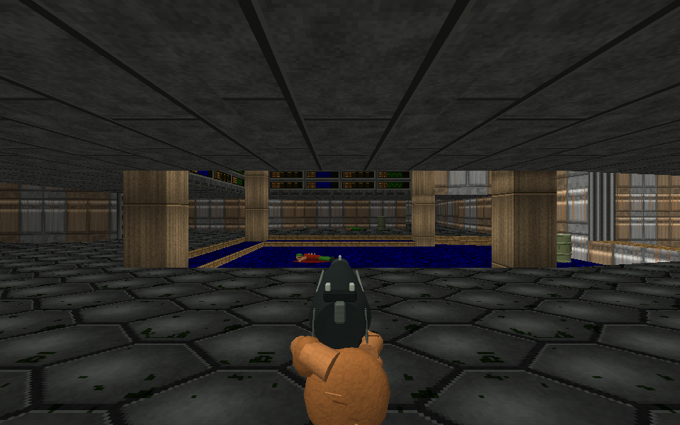

# DOOM · FERRO — Hangar procédural en 3D

**E1M1 reconstruit par le code et rendu par le moteur FERRO 0.3.33.** Version du jeu : **0.4.0**.

Le runtime ne charge aucun WAD, fichier image, modèle ou enregistrement sonore. Les générateurs construisent la géométrie, les matériaux, le ciel, les personnages, les objets, les armes, le HUD, les effets sonores et une musique originale. Ils utilisent des calculs, des primitives et des graines déterministes ; aucun média encodé ne remplace les anciens fichiers.

Le **tracé d’E1M1 est un plan fixe de référence** : coordonnées des murs, hauteurs, connexions, mécanismes et placements constituent les paramètres de construction. Le niveau n’est donc pas aléatoire. Les surfaces et leur triangulation sont calculées au lancement depuis ces contours, sans reprendre le BSP ni les triangles originaux.

Les visuels prennent maintenant les **assets de Doom PC de 1993 comme références directes** : dimensions des textures, motifs des panneaux, palettes, silhouettes, vêtements, objets et armes. Les ennemis, les objets, les cadavres, les projectiles et l’arme tenue sont des **maillages 3D générés**, avec leurs propres faces, normales et profondeur. Aucun de ces éléments n’est une image tournée vers la caméra. Les parties non visibles dans les dessins d’origine sont reconstruites en volume ; les recettes ne revendiquent pas une identité pixel par pixel. La musique reste une composition procédurale originale.

## Lancer

Python 3 et un navigateur prenant en charge WebGL 2 suffisent. Aucun gestionnaire de dépendances, CDN ou serveur de jeu n’est nécessaire.

```sh
git clone https://github.com/M4D135/DOOM-FERRO.git
cd DOOM-FERRO
python3 tools/build.py
python3 -m http.server 8080 --directory dist
```

Ouvrir **http://localhost:8080**. Les modules JavaScript nécessitent un serveur HTTP. Le build fonctionne sans le dossier `reference/` et le jeu n’effectue aucune requête de média ni vers un domaine tiers.

## Ce qui est généré

| Élément | Construction |
|---|---|
| Carte | Balayage des contours des 85 secteurs du plan, création de 295 cellules convexes ; triangulation et index spatial calculés |
| Murs, sols et plafonds | Métal, rivets, panneaux, écrans, pierre, éclairages et fluides produits à partir de motifs et de bruits déterministes |
| Ciel | Nuages gris et crêtes rocheuses calculés d’après SKY1 |
| Ennemis | Volumes triangulés des zombiemen, shotgun guys et imps ; marche, attaque, douleur et chute ; orientation propre à chaque acteur |
| Objets et effets | Barils, lampes, colonnes, armures, bonus, caisses de soins, munitions, armes au sol, corps, boules de feu et explosions en 3D |
| Armes en main | Pistolet, fusil à pompe et poing en 3D ; mains, recul, pompage et flashes en volume |
| HUD et logo | Interface 2D calculée : barre grise, chiffres rouges, visage nu et logo bleu/or ; contours vectoriels sans police bitmap extraite |
| Sons | Oscillateurs, bruit déterministe, filtres et enveloppes ; spatialisation selon la position du joueur |
| Musique | Composition originale par règles : basse, batterie, drone et mélodie ; aucune partition extraite |

Les ressources visuelles sont créées à la demande puis mises en cache. Les poses identiques partagent leur géométrie et sont rendues par instanciation. Changer l’angle de la caméra ne change ni le maillage ni l’orientation d’un acteur. Les effets sonores sont calculés une fois et réutilisés. La musique conserve sa position lors des pauses. Le nombre de voix simultanées est plafonné à 24.

## Détail des modèles en 0.4.0

Les personnages utilisent maintenant des profils anatomiques continus, des visages sculptés par fonctions, des yeux et paupières, une cavité buccale avec dents séparées, des mains articulées, des vêtements avec poches, coutures et plis, ainsi que des bottes avec semelles et lacets. L’imp possède des volumes de torse continus, des griffes et des pointes intégrées aux membres. Les mains des soldats suivent les prises de leur arme dans le même repère 3D.

Les objets possèdent des rebords, collerettes, fixations, poignées, fermoirs, câbles et cartouches séparées suivant leur famille. Les armes en main ont des pièces de carcasse, des organes de visée, une détente et son pontet, des vis, une bouche de canon, une pompe et des mains détaillées. Les pièces fixes sont générées une fois puis transformées pour les poses de recul et de pompage.

Les chanfreins et les profils arrondis modifient réellement les silhouettes. Les matériaux distinguent peau, tissu, cuir, métal, peinture, os, verre, bois, sang et surfaces lumineuses. Grain, fibres, usure légère, rugosité et reflets sont calculés dans les shaders à partir de coordonnées locales conservées pendant les animations. Aucun fichier de texture ni de modèle supplémentaire n’est chargé.

Les recettes proposent trois niveaux géométriques suivant la distance, avec une marge de transition pour éviter des changements incessants à la limite. Le test de visibilité précède la génération du maillage. Les compteurs F3 indiquent les niveaux utilisés, les objets écartés et la mémoire des buffers de modèles.

L’inventaire de géométrie est mesuré directement depuis les buffers générés dans [model-detail.json](docs/qa/model-detail.json). Ces comptes correspondent à la pose au repos ou à la première image d’animation ; ils varient pendant certaines actions.

| Modèle | Proche | Intermédiaire | Lointain |
|---|---:|---:|---:|
| Zombieman | 11 480 | 4 876 | 1 668 |
| Shotgun guy | 11 248 | 4 840 | 1 664 |
| Imp | 9 048 | 4 628 | 1 752 |
| Baril | 3 344 | 1 296 | 308 |
| Colonne technique | 4 752 | 1 368 | 232 |
| Armure | 2 784 | 1 128 | 264 |
| Fusil au sol | 3 560 | 1 808 | 222 |

Les armes en main restent détaillées : **4 536 triangles pour le pistolet**, **9 120 pour le fusil**, **2 364 pour le poing**. Un flash de tir ajoute 206 triangles. Les pièces communes des trois familles de personnages et les premières poses d’armes sont préparées pendant le chargement, en laissant le navigateur afficher entre les recettes. Les autres poses sont construites à la demande ; aucune cadence d’image sur appareil physique n’est déduite de ces comptes.

## Commandes

| Action | Clavier et souris | Manette | Tactile |
|---|---|---|---|
| Se déplacer | ZQSD / WASD, flèches haut et bas | Stick gauche | Joystick gauche |
| Regarder | Souris, flèches gauche et droite | Stick droit | Glisser sur la moitié droite |
| Tirer | Clic gauche / Ctrl | RT | TIR |
| Ouvrir / utiliser | E / Espace | A ou X | UTILISER |
| Courir | Maj | L3 ou LB | Activé avec le joystick |
| Changer d’arme | 1 : poing, 2 : pistolet, 3 : fusil ; molette | Y / RB | ARME |
| Carte | Tab | View / Select | CARTE |
| Pause | Échap | Start | Ⅱ |
| Diagnostic du rendu et position | F3 | — | — |

Le navigateur demande le verrouillage de la souris au démarrage. Échap libère la souris et met le jeu en pause. Sur mobile, le paysage donne la plus grande surface de jeu.

Au menu, la croix directionnelle ou le stick gauche de la manette choisit la difficulté ; A ou Start démarre. La souris reste utilisable sur un PC à écran tactile. Après une pause, relâcher puis presser de nouveau une gâchette maintenue permet de reprendre le tir. Un geste clavier, souris ou tactile active l’audio si le démarrage a eu lieu à la manette.

## Gameplay et portes

Le jeu comprend déplacements et collisions, escaliers, portes, ascenseur secret, sol mobile, secrets, interrupteur de sortie, santé, armure, munitions, trois armes, ennemis et barils. Les collisions consultent les hauteurs courantes des secteurs, également utilisées pour reconstruire les surfaces visibles. Les cellules générées servent à la fois au rendu des sols et à la localisation des acteurs.

Les tests traversent les huit faces des quatre portes en avançant pendant leur ouverture, avec les entités présentes. Un parcours du départ à la sortie utilise les déplacements et interactions réels de la simulation avec les six ennemis actifs. Un ennemi vivant ou un baril solide peut occuper un passage ; un cadavre ne doit plus le bloquer.

**Le blocage de porte signalé dans la version précédente n’a pas été reproduit lors de ces contrôles.** Aucun assouplissement arbitraire des collisions n’est présenté comme un correctif. Le panneau F3 affiche maintenant les coordonnées et l’orientation nécessaires pour identifier une situation précise. Les modules du build portent une révision commune afin qu’un rechargement ne mélange pas d’anciennes et de nouvelles versions du code.

La portée actuelle reste **E1M1 en solo**. La simulation est une réimplémentation : l’IA, les déplacements et les temporisations ne revendiquent pas une équivalence binaire avec l’exécutable original. Les autres niveaux, le multijoueur et la compatibilité avec les démos Doom ne font pas partie de cette version.

## Intégration de FERRO

Référence canonique : [M4D135/FERRO](https://github.com/M4D135/FERRO), version **0.3.33**, commit `a443359c4741a815f384278e6427a33758d79f2f`.

Les quatre modules utilisés sont conservés octet pour octet dans `vendor/ferro/` : `fmath.js`, `surface.js`, `renderer.js`, `engine.js`. Le manifeste associe chaque fichier à son SHA256 et à son objet Git amont. La construction et les tests vérifient ces empreintes.

FERRO crée le contexte WebGL, contrôle la résolution, les matrices de caméra et de projection, les cibles de rendu, la profondeur, la compilation des shaders, le cycle d’image et les statistiques. L’adaptateur `src/ferro-doom-renderer.js` fournit les surfaces et les modèles 3D générés dans le point d’extension `fx.foule.couleur` de `FRender.draw`. Aucun autre moteur de rendu n’est inclus.

Les générateurs et les règles de Doom, dont les collisions par secteurs, appartiennent au jeu. Le noyau canonique de FERRO reste inchangé.

Le budget d’image atteint **576 000 pixels** sur les périphériques à pointeur précis (960 × 600 de référence, adapté au ratio de l’écran) et reste à **256 000 pixels** sur les périphériques à pointeur grossier. La carte initiale comporte **2 025 triangles**. Les modèles proches reçoivent la géométrie détaillée ; leurs versions intermédiaires et lointaines réduisent le coût. Les buffers de modèles GPU sont limités à **64 Mio**, avec éviction des poses les moins récemment utilisées ; leurs caches CPU sont également bornés en octets. Les buffers de carte sont réutilisés et ne sont reconstruits que lorsque la géométrie ou une texture de secteur change. F3 affiche les nombres de modèles et de triangles effectivement soumis. Aucune mesure FPS sur Xbox ou téléphone physique n’est revendiquée.

## Organisation

| Fichier ou dossier | Rôle |
|---|---|
| `src/e1m1-plan.js` | Paramètres d’architecture et de placements du plan fixe |
| `src/procedural-map.js` | Génération des cellules, géométrie et index spatial |
| `src/procedural-materials.js` | Recettes de murs, sols, plafonds et ciel |
| `src/procedural-raster.js` | Primitives de dessin des ressources |
| `src/procedural-mesh.js` | Primitives fermées, chanfreins, profils, normales, matériaux et transformations |
| `src/procedural-characters.js` | Maillages et poses des trois familles d’ennemis |
| `src/procedural-objects.js` | Objets, corps et projectiles 3D, trois niveaux géométriques |
| `src/procedural-weapons.js` | Armes, mains et animation des pièces préconstruites |
| `src/procedural-models.js` | Sélection des recettes, visibilité, niveaux de détail et groupes d’instances |
| `src/procedural-interface.js` | HUD et logo calculés, sans images de personnages ni d’armes |
| `src/procedural-resources.js` | Accès et comptage des ressources générées |
| `src/procedural-audio.js` | Synthèse des sons, composition et lecture musicales |
| `src/ferro-doom-renderer.js` | Adaptateur de rendu dans FERRO |
| `src/game.js` | Simulation, collisions, armes, ennemis et mécanismes |
| `src/app.js`, `src/input.js` | Interface, commandes, HUD et boucle du jeu |
| `tools/build.py` | Vérification de FERRO et build du seul graphe runtime |
| `tools/verify.py` | Qualification mesurée et double construction reproductible |
| `reference/`, `tests/reference/` | Archive et outils de recherche, exclus du runtime et de sa qualification |

## Vérifier

Les tests utilisent Node.js 20 ou plus récent :

```sh
node --test tests/*.test.mjs
python3 tools/build.py
```

Pour exécuter les tests, construire deux fois et enregistrer les preuves mesurées :

```sh
python3 tools/verify.py --write-report
```

Pour refaire l’inventaire de modèles : `node tools/measure-models.mjs > docs/qa/model-detail.json`.

Le rapport `docs/qa/validation.json` conserve le nombre réel de tests, la révision du build, sa taille et sa reproductibilité. Le journal TAP complet est dans `docs/qa/node-tests.txt`. Le test de build utilise une copie temporaire contenant uniquement le code, le moteur et l’interface : aucune archive n’est disponible. Il vérifie les dépendances, leurs révisions, l’absence de média livré, la suppression des anciennes sorties et les empreintes de FERRO.

Les tests de commandes exécutent les gestionnaires de l’application avec un DOM et des périphériques simulés, la vraie carte générée et la vraie simulation. Les contrôles de synthèse audio portent sur les signaux, la spatialisation et le cycle de vie avec un contexte audio simulé.

Les tests de modèles vérifient les volumes, les normales, les poses, les limites de cache, les objets des trois difficultés et l’indépendance par rapport à la caméra. Ils contrôlent aussi la fermeture des nouvelles primitives, la conservation des coordonnées de matière lors des transformations, les limites du champ de vision, l’hystérésis des niveaux de détail et la libération effective des buffers GPU. Les tests de l’interface empêchent le retour d’une image de personnage ou d’arme par l’API du HUD.

Le script `python3 tests/render-egl.py` compile les six shaders de production et produit 31 images de contrôle avec EGL/Mesa : niveau, armes au repos et en action, personnages de face/profil/dos, portraits, objets en gros plan et porte ouverte. Son rapport `docs/qa/egl-report.json` enregistre la géométrie, les niveaux de détail, les vues et les empreintes des modules utilisés. Les scènes de studio et de porte contenant un acteur sont des placements contrôlés pour la vérification visuelle.



Ces images sont des **rendus OpenGL hors écran des shaders et données de production**, pas des captures de partie dans un navigateur. Le navigateur distant ne fournissait pas de contexte WebGL 2 lors du contrôle précédent ; l’accès au nouvel aperçu a ensuite été refusé par sa politique d’URL. La vérification interactive complète, le mixage audible, une manette physique et les performances sur téléphone/Xbox restent à confirmer sur ces appareils.

GitHub Actions n’a pas pu démarrer lors de la qualification précédente, à cause d’un blocage de facturation ou de plafond du compte. Les résultats locaux et EGL sont distincts de cette qualification distante. Le workflow conserve le contrôle `--check-committed` pour comparer les fichiers de `dist/` à un nouveau build.

## Référence et provenance

`reference/doom1.wad` est conservé comme archive de recherche, avec sa provenance, les anciens lecteurs et leurs tests séparés. Il n’est ni nécessaire au build, ni copié dans `dist/`, ni chargé par le jeu. L’outil `tools/export-e1m1-plan.mjs` permet de refaire le relevé architectural lors du développement.

La démarche de fidélité, les familles inspectées et les captures publiques de référence sont détaillées dans [les références visuelles](docs/visual-reference.md).

Taille de l’archive : **4 196 020 octets**. SHA256 : `1d7d43be501e67d927e415e0b8f3e29c3bf33075e859721816f652a526cac771`.

- [Archive shareware de référence](https://ftp.fu-berlin.de/pc/games/idgames/idstuff/doom/win95/doom95.zip)
- [Source publiée des règles et formats Doom](https://github.com/id-Software/DOOM)
- Conditions shareware conservées dans `docs/DOOM-SHAREWARE-README.TXT`

Les données du plan et les marques Doom appartiennent à id Software et à leurs ayants droit. Les conditions de l’archive de référence sont distinctes de celles du code du jeu et du moteur FERRO.
