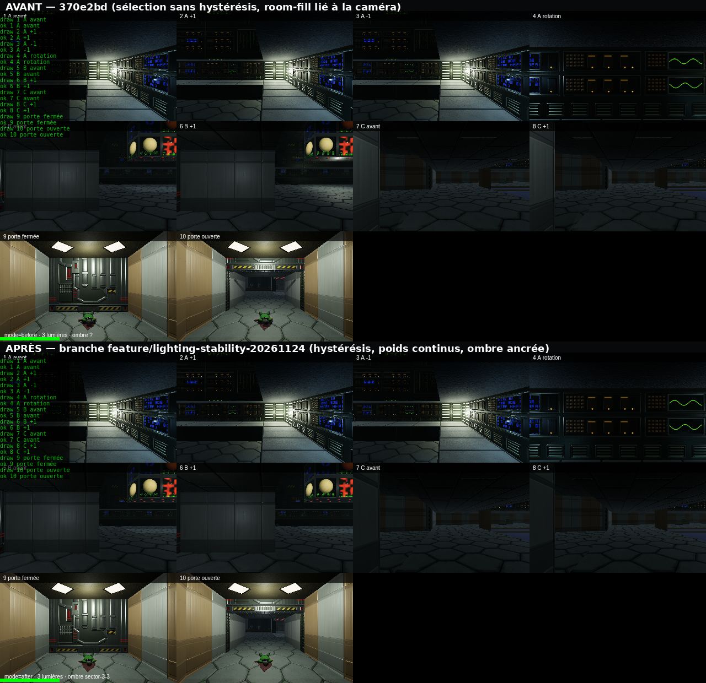

# DOOM · FERRO — Épisode 1 procédural en 3D

**Les neuf missions d’Épisode 1 (*Knee-Deep in the Dead*, E1M1 à E1M9) reconstruites par le code et rendues par le moteur FERRO 0.3.33.** Version du jeu : **0.7.0**.

Le runtime ne charge aucun WAD, fichier image, modèle ou enregistrement sonore. Les générateurs construisent la géométrie, les matériaux, le ciel, les personnages, les objets, les armes, le HUD, les effets sonores et une musique originale par niveau. Ils utilisent des calculs, des primitives et des graines déterministes ; aucun média encodé ne remplace les anciens fichiers.

Les **tracés d’E1M1 à E1M9 sont des plans fixes de référence** : coordonnées des murs, hauteurs, connexions, mécanismes et placements constituent les paramètres de construction. Les niveaux ne sont donc pas aléatoires. Les surfaces et leur triangulation sont calculées au lancement depuis ces contours, sans reprendre le BSP ni les triangles originaux.

Les visuels prennent maintenant les **assets de Doom PC de 1993 comme références directes** : dimensions des textures, motifs des panneaux, palettes, silhouettes, vêtements, objets et armes. Les ennemis, les objets, les cadavres, les projectiles et l’arme tenue sont des **maillages 3D générés**, avec leurs propres faces, normales et profondeur. Aucun de ces éléments n’est une image tournée vers la caméra. Les parties non visibles dans les dessins d’origine sont reconstruites en volume ; les recettes ne revendiquent pas une identité pixel par pixel. La musique reste une composition procédurale originale.

## Lancer

**Le jeu complet est livré dans un seul fichier : `dist/index.html`.** Il contient les styles, les quatre modules canoniques FERRO et tous les générateurs. Il peut être déplacé seul et ouvert localement dans un navigateur prenant en charge WebGL 2 ; aucun fichier voisin, CDN ou serveur de jeu n’est nécessaire.

Pour reconstruire ce fichier depuis les sources, Python 3 suffit :

```sh
git clone https://github.com/M4D135/DOOM-FERRO.git
cd DOOM-FERRO
python3 tools/build.py
```

Ouvrir ensuite `dist/index.html`. Pour un accès HTTP facultatif, lancer `python3 -m http.server 8080 --directory dist`, puis ouvrir **http://localhost:8080**. Le build fonctionne sans le dossier `reference/` ; le jeu ne charge aucune dépendance ni média.

Les sources de développement restent séparées dans `src/` pour garder les générateurs lisibles. Le linker réunit leur graphe statique dans des portées isolées, conserve les scripts FERRO octet pour octet et échoue sur une dépendance absente, un cycle ou une syntaxe de module non prise en charge. Le résultat utilise des scripts classiques intégrés, sans import de module depuis une URL `file:`, `eval`, archive encodée ni décompression au démarrage. Les métadonnées et empreintes du moteur sont incluses dans un bloc JSON du même HTML.

## Ce qui est généré

| Élément | Construction |
|---|---|
| Carte | Balayage des contours des secteurs des 9 plans d’Épisode 1 (`E1M1`–`E1M9`), création de cellules convexes ; triangulation, états initiaux et index spatial calculés |
| Murs, sols et plafonds | Métal, rivets, panneaux, écrans, pierre, éclairages et fluides produits à partir de motifs et de bruits déterministes (100 % des surfaces des 9 missions couvertes) |
| Ciel | Nuages gris et crêtes rocheuses calculés d’après SKY1 |
| Ennemis | Volumes triangulés des zombiemen, shotgun guys, sergents, imps, spectres et barons ; marche, attaque, douleur et chute ; orientation propre à chaque acteur |
| Objets et effets | Barils, lampes, colonnes, armures, bonus, caisses de soins, munitions, clés, sac à dos, combinaison, lunettes, carte, armes au sol, corps, boules de feu, missiles et explosions en 3D |
| Armes en main | Poing, pistolet, fusil à pompe, mitraillette, lance-missiles et tronçonneuse en 3D ; mains, recul, pompage et flashes en volume |
| HUD et logo | Interface 2D calculée : barre grise, chiffres rouges/jaunes, cartes d’accès possédées (`STKEYS0–2`), visage nu et logo bleu/or ; contours vectoriels sans police bitmap extraite |
| Sons | Oscillateurs, bruit déterministe, filtres et enveloppes ; spatialisation selon la position du joueur |
| Musique | Composition originale déterministe distincte pour chacune des neuf missions ; aucune partition extraite |

Les ressources visuelles sont créées à la demande puis mises en cache. Les poses identiques partagent leur géométrie et sont rendues par instanciation. Changer l’angle de la caméra ne change ni le maillage ni l’orientation d’un acteur. Les effets sonores sont calculés une fois et réutilisés. La musique conserve sa position lors des pauses. Le nombre de voix simultanées est plafonné à 24.

## Volumes, matières et lumière en 0.6.0

Cette refonte reprend ensemble les formes et leur éclairage. Les têtes, torses et membres utilisent des surfaces anatomiques continues. Les courbes tiennent compte de l’espacement réel des repères pour conserver des normales lisses. Les bras et jambes se déforment autour des articulations ; le transport de leurs repères et des normales évite les retournements aux coudes. Les yeux, paupières, oreilles, lèvres et dents sont des volumes distincts intégrés à la tête. Les cols et poches sont des panneaux courbes à épaisseur réelle.

Les manches et les bras humains partagent le même pivot et la même courbure articulée. La peau recouverte commence sous le revers, ce qui évite ses intersections avec le tissu au repos et pendant la visée.

Les mains des armes utilisent des surfaces implicites fusionnées, avec paumes, pouces, doigts et poignets raccordés. Le pistolet et le fusil possèdent une carcasse profilée, des assemblages, une chambre, des organes de visée, un pontet réellement ouvert et une bouche de canon creuse. Le bois de la crosse et de la pompe suit une seule surface. Les barils, colonnes, armures, casques, flacons et trousses reçoivent des rebords, épaisseurs, joints, charnières, câbles et fixations adaptés à leur construction.

Le rendu des matières est repris avec **GGX, Smith corrélé et Schlick**, calculés en lumière linéaire, puis une courbe filmique et une conversion d’affichage. Les modèles distinguent peau, tissu, cuir, métal, peinture, os, verre, bois, sang et surfaces lumineuses. Pores, fibres et grain sont calculés dans leurs coordonnées locales, conservées pendant les mouvements. Les visages restent des reconstructions sculptées stylisées ; cette version ne revendique pas un photoréalisme acquis.

Les murs, portes, consoles, sols et plafonds disposent de **trois cartes calculées indépendamment** : couleur/couverture, normale/rugosité et métal/occlusion/émission/hauteur. Les grands motifs et dimensions de Doom sont conservés ; les détails sont évalués à la nouvelle résolution, jusqu’à 1024 pixels sur le grand côté. La parallaxe ajoute du relief apparent aux surfaces proches ; elle ne change ni les silhouettes architecturales ni les collisions. Les mipmaps, le filtrage linéaire et l’anisotropie disponible réduisent le scintillement à distance.

Jusqu’à **huit sources locales** proviennent des plafonds et lampes murales du plan, écrans d’ordinateur, ouvertures extérieures, bassins toxiques et effets de tir. Le remplissage artificiel des pièces est réduit ; des ombres plus froides, une lumière fluorescente localisée et une brume de distance discrète donnent une ambiance plus lugubre. Les secteurs et leurs niveaux lumineux originaux restent inchangés. Les secteurs qui clignotent ou pulsent modulent aussi la lumière directe.

Le choix des sources retenues est **stable dans le temps** : une lampe n’entre en jeu que si elle reste à moins de 1,4 fois sa portée et n’en sort qu’au-delà de 1,7 fois cette portée, avec un fondu d’entrée et de sortie de 0,18 seconde ; la sélection précédente est transmise au frame suivant par le moteur. Une lampe voisine ne peut donc plus apparaître ou disparaître d’un seul pas de joueur, et son intensité varie continûment. Le remplissage d’une pièce est ancré au centre du secteur qui l’éclaire, non à la caméra : tourner sur place ne le déplace plus. La source d’ombre principale est choisie de la même façon et son repère vient du secteur, ce qui fige la projection des ombres du monde pendant un mouvement de tête. Les éclairs de tir et les projectiles occupent un budget transitoire séparé et ne déplacent plus les lampes fixes. Une carte de profondeur produit les ombres du monde ; une seconde, ajustée à la géométrie visible de l’arme, résout les petits contacts autour des mains. Les objets hors cadre peuvent encore projeter une ombre dans le champ. Les comparaisons de profondeur filtrées sont complétées par une occlusion de contact qui utilise les normales lisses, puis un léger filtrage des contours.

L’éclairage indirect, la transmission de la peau et les réflexions d’environnement restent des approximations. Ce chemin n’est ni du ray tracing, ni un calcul complet d’illumination globale. Le fonctionnement exact, les sources des formules et les limites sont décrits dans [procedural-rendering.md](docs/procedural-rendering.md).

### Géométrie et caches

Les visages ont été repris dans leurs volumes : orbites plus enfoncées, paupières resserrées, pommettes et mâchoires creusées, bouches asymétriques et raccords du cou corrigés. L’Imp possède une posture plus ramassée et des pointes mieux proportionnées. Les vêtements reçoivent des plis suivant leur coupe. Le poing, le poignet et l’avant-bras forment une surface continue ; les cadavres et les restes PLAYN, PLAYW et POL5 utilisent des constructions distinctes d’après leurs références. Les masses coagulées des restes ont une rugosité variable majoritairement mate, avec quelques replis humides ; leur version lointaine conserve cette apparence globale. La patine des armures, barils, armes et trousses est calculée selon leur forme et leur hauteur, sans image plaquée.

Les trois niveaux géométriques partagent leurs designs et leur rig. Une marge autour des distances de transition évite les changements incessants de détail. La visibilité est testée avant de générer une pose. Les pièces fixes sont construites une fois, puis les poses sont composées directement dans des tableaux Float32. Les ombres d’objets uniquement hors champ utilisent au plus le niveau intermédiaire.

L’inventaire ci-dessous provient des buffers réels, au repos ou à la première image d’animation ; il ne mesure pas les FPS. Le fichier [model-detail.json](docs/qa/model-detail.json) contient les autres familles, les poses d’action, les dimensions, les matières et les empreintes des sources.

| Modèle | Proche | Intermédiaire | Lointain |
|---|---:|---:|---:|
| Zombieman | 33596 | 7208 | 1676 |
| Shotgun guy | 30240 | 6944 | 1624 |
| Imp | 25288 | 6088 | 1816 |
| Baril | 6440 | 1496 | 350 |
| Colonne technique | 11840 | 1932 | 288 |
| Armure | 8400 | 2192 | 368 |
| Fusil au sol | 9124 | 2380 | 344 |

Les armes tenues au repos comptent **12 460 triangles pour le pistolet**, **23 532 pour le fusil** et **10 628 pour le poing**. Le flash volumique ajoute 206 triangles aux armes à feu. Les pièces communes, premières poses et cartes de matière sont préparées pendant un chargement avec progression affichée, en laissant le navigateur afficher entre les recettes.

Les buffers CPU conservés sont bornés : 32 Mio de pièces de personnages et 32 Mio de poses, 12 Mio d’objets, 20 Mio d’armes et 48 Mio de cartes de surfaces incluant leur tampon de hauteur temporaire. Ces valeurs ne représentent pas la mémoire totale du navigateur. Les modèles GPU restent plafonnés à 64 Mio. L’ensemble possible des 56 matières d’E1M1 utilise environ 178,2 Mio de textures GPU avec mipmaps sur ordinateur, ou 42,1 Mio avec la limite mobile de 256 pixels ; les cibles couleur, normales, profondeur et ombres s’ajoutent à ce compte.

## Commandes

| Action | Clavier et souris | Manette | Tactile |
|---|---|---|---|
| Se déplacer | ZQSD / WASD, flèches haut et bas | Stick gauche | Joystick gauche |
| Regarder | Souris, flèches gauche et droite | Stick droit | Glisser sur la moitié droite |
| Tirer | Clic gauche / Ctrl | RT | TIR |
| Ouvrir / utiliser | E / Espace | A ou X | UTILISER |
| Courir | Maj | L3 ou LB | Activé avec le joystick |
| Changer d’arme | 1 : poing, 2 : pistolet, 3 : fusil, 4 : mitraillette, 5 : lance-missiles, 6 : tronçonneuse ; molette | Y / RB | ARME |
| Carte | Tab | View / Select | CARTE |
| Pause | Échap | Start | Ⅱ |
| Diagnostic du rendu et position | F3 | — | — |

Le navigateur demande le verrouillage de la souris au démarrage. Échap libère la souris et met le jeu en pause. Sur mobile, le paysage donne la plus grande surface de jeu.

Au menu, la croix directionnelle ou le stick gauche de la manette choisit la difficulté ; A ou Start démarre. La souris reste utilisable sur un PC à écran tactile. Après une pause, relâcher puis presser de nouveau une gâchette maintenue permet de reprendre le tir. Un geste clavier, souris ou tactile active l’audio si le démarrage a eu lieu à la manette.

## Gameplay et portes

Le jeu comprend déplacements et collisions, escaliers montants chaînés (`7`, `8`), donut d’E1M2 (`9`), portes simples, verrouillées par cartes et commandées par interrupteurs ou au tir (`46`), ponts montants avec neutralisation d’acide (`18`, `22`), plateformes rapides (`23`, `36`, `70`, `82`, `91`, `98`), pièges temporisés (`16`, `76`), extinction de lumière (`35`), ascenseurs (`62`, `88`), téléporteurs (`97`), ouverture `tag 666` à la mort des Barons d’E1M8, interrupteurs de sortie normale (`11`) et secrète (`51`, `E1M3 → E1M9 → E1M4`), santé, armure, sac à dos doublant les réserves, six armes, six types d’ennemis et barils explosifs. Les collisions consultent les hauteurs courantes des secteurs, également utilisées pour reconstruire les surfaces visibles. Les cellules générées servent à la fois au rendu des sols et à la localisation des acteurs, et chaque nouvelle partie restaure l’état géométrique et les textures d’origine du plan.

Les tests traversent les huit faces des quatre portes en avançant pendant leur ouverture, avec les entités présentes. Un parcours du départ à la sortie utilise les déplacements et interactions réels de la simulation avec les six ennemis actifs. Un ennemi vivant ou un baril solide peut occuper un passage ; un cadavre ne doit plus le bloquer.

**Le blocage de porte signalé dans la version précédente n’a pas été reproduit lors de ces contrôles.** Aucun assouplissement arbitraire des collisions n’est présenté comme un correctif. Le panneau F3 affiche maintenant les coordonnées et l’orientation nécessaires pour identifier une situation précise. Le HTML contient désormais la totalité du runtime : un rechargement ne peut plus mélanger des modules séparément mis en cache.

Les **trois secrets** de la référence shareware 1.9 sont vérifiés par un second parcours continu : accès à la cour et à l’armure bleue, alcôve du fusil après descente de la plateforme, puis ascenseur minuté et galerie haute avec retour par sa fenêtre. Il conserve tous les ennemis, les munitions, les objets et les collisions jusqu’à la sortie. La découverte exige le contact au sol, l’IA respecte la face de porte marquée secrète et les sons des mécanismes proviennent des secteurs mobiles. Les déclenchements, hauteurs et références sont détaillés dans [e1m1-secrets.md](docs/e1m1-secrets.md).

La portée couvre désormais **les neuf missions d’Épisode 1 en solo** (`E1M1` à `E1M9`), accessibles en progression continue avec écran de résultats ou directement via le sélecteur de mission du menu principal. La simulation reste une réimplémentation : l’IA, les déplacements et les temporisations ne revendiquent pas une équivalence binaire avec l’exécutable original. Les épisodes 2 à 4, le multijoueur et la compatibilité avec les démos Doom ne font pas partie de cette version.

## Intégration de FERRO

Référence canonique : [M4D135/FERRO](https://github.com/M4D135/FERRO), version **0.3.33**, commit `a443359c4741a815f384278e6427a33758d79f2f`.

Les quatre modules utilisés sont conservés octet pour octet dans `vendor/ferro/` : `fmath.js`, `surface.js`, `renderer.js`, `engine.js`. Le manifeste associe chaque fichier à son SHA256 et à son objet Git amont. La construction et les tests vérifient ces empreintes.

FERRO crée le contexte WebGL, contrôle la résolution, les matrices de caméra et de projection, les cibles de rendu, la profondeur, la compilation des shaders, le cycle d’image et les statistiques. L’adaptateur `src/ferro-doom-renderer.js` fournit les surfaces et les modèles 3D générés dans le point d’extension `fx.foule.couleur` de `FRender.draw`. Aucun autre moteur de rendu n’est inclus.

Les générateurs et les règles de Doom, dont les collisions par secteurs, appartiennent au jeu. Le noyau canonique de FERRO reste inchangé.

Le budget d’image atteint **1 024 000 pixels** sur les périphériques à pointeur précis (1280 × 800 de référence, adapté au ratio de l’écran) et reste à **256 000 pixels** sur les périphériques à pointeur grossier. La carte initiale comporte **2 025 triangles**. Les modèles proches reçoivent la géométrie détaillée ; leurs versions intermédiaires et lointaines réduisent le coût. Les buffers de modèles GPU sont limités à **64 Mio**, avec éviction des poses les moins récemment utilisées ; leurs caches CPU sont également bornés en octets. Les buffers de carte sont réutilisés et ne sont reconstruits que lorsque la géométrie ou une texture de secteur change. F3 affiche les nombres de modèles et de triangles effectivement soumis, la source d’ombre retenue, ainsi que les images par seconde et le temps réel mesuré entre deux images. Le compteur d’images par seconde utilise `src/frame-timing.js`, qui sépare le temps réel écoulé du pas de simulation borné à 0,05 seconde : une image longue n’affiche plus une fausse valeur figée et le temps de simulation ne peut plus bondir après une pause. Aucune mesure FPS sur Xbox ou téléphone physique n’est revendiquée.

## Organisation

| Fichier ou dossier | Rôle |
|---|---|
| `src/e1m1-plan.js` | Paramètres d’architecture et de placements du plan fixe |
| `src/procedural-map.js` | Génération des cellules, géométrie et index spatial |
| `src/procedural-materials.js` | Dimensions et recettes de référence des matériaux |
| `src/procedural-surface-detail.js` | Cartes PBR continues, hauteurs et cache CPU des surfaces |
| `src/procedural-shaders.js` | Programmes monde, modèles, ciel, ombres et post-traitement |
| `src/procedural-lighting.js` | Sélection stable des sources locales, pulsations et projections des ombres |
| `src/procedural-raster.js` | Primitives de dessin des ressources |
| `src/procedural-mesh.js` | Primitives fermées, chanfreins, profils, normales, matériaux et transformations |
| `src/procedural-characters.js`, `src/procedural-anatomy.js` | Surfaces anatomiques et poses des trois familles d’ennemis |
| `src/procedural-objects.js` | Objets et projectiles 3D, trois niveaux géométriques |
| `src/procedural-remains.js`, `src/procedural-object-finish.js` | Corps et restes distincts suivant les références ; patine et rugosité calculées sur les objets |
| `src/procedural-weapons.js`, `src/procedural-object-sculpt.js` | Armes, surfaces implicites des mains et animation des pièces |
| `src/procedural-models.js` | Sélection des recettes, visibilité, niveaux de détail et groupes d’instances |
| `src/procedural-interface.js` | HUD et logo calculés, sans images de personnages ni d’armes |
| `src/procedural-resources.js` | Accès et comptage des ressources générées |
| `src/procedural-audio.js` | Synthèse des sons, composition et lecture musicales |
| `src/ferro-doom-renderer.js` | Adaptateur de rendu dans FERRO |
| `src/game.js` | Simulation, collisions, armes, ennemis et mécanismes |
| `src/app.js`, `src/input.js` | Interface, commandes, HUD et boucle du jeu |
| `src/frame-timing.js` | Séparation du temps réel affiché et du pas de simulation borné |
| `tools/build.py` | Vérification de FERRO et assemblage du graphe runtime dans un HTML autonome |
| `tools/verify.py` | Qualification mesurée et double construction reproductible |
| `tools/measure-lighting.mjs` | Rejeu des trajets de caméra et compte des apparitions brutales d’éclairage |
| `reference/`, `tests/reference/` | Archive et outils de recherche, exclus du runtime et de sa qualification |

## Vérifier

Les tests utilisent Node.js 20 ou plus récent :

```sh
node --test tests/*.test.mjs
python3 tools/build.py
```

Pour exécuter les tests, construire deux fois et enregistrer les preuves mesurées :

```sh
python3 tools/verify.py --write-report
```

Pour refaire l’inventaire de modèles : `node tools/measure-models.mjs > docs/qa/model-detail.json`.

Le rapport `docs/qa/validation.json` conserve le nombre réel de tests, la révision du build, sa taille et sa reproductibilité. Le journal TAP complet est dans `docs/qa/node-tests.txt`. Le test de build utilise une copie temporaire contenant uniquement le code, le moteur et l’interface : aucune archive n’est disponible. Il vérifie le fichier unique, l’intégration du CSS et des scripts, l’absence de ressource externe ou de média livré, la suppression des anciennes sorties, les empreintes FERRO et la reproductibilité. Les scripts exacts du HTML sont également exécutés dans une VM Node jusqu’au repli WebGL contrôlé ; ce test de liaison ne remplace pas une ouverture interactive du fichier.

Les tests de passes exécutent le véritable adaptateur avec un WebGL 2 simulé qui suit les ressources et les samplers : ils vérifient les cibles couleur/normales/profondeur, l’absence de lecture d’une texture attachée à la cible courante, le retour à la cible FERRO et la libération des buffers au redimensionnement et à la fermeture. Les tests d’éclairage vérifient notamment les portes, les pulsations des secteurs, les ombres hors champ et le cadrage de l’ombre des armes. Les tests de stabilité de l’éclairage (`tests/lighting-stability.test.mjs`) rejouent trois déplacements d’un pas de l’E1M1 réel et exigent que la lampe voisine, le remplissage du secteur et la source d’ombre restent les mêmes, que la projection d’ombre ne bouge pas pendant un mouvement de tête, et qu’un éclair de tir ne retire aucune lampe fixe. `tests/frame-timing.test.mjs` contrôle la séparation du temps réel et du pas de simulation. La compilation et les pixels sont contrôlés séparément par EGL.

Les tests de commandes exécutent les gestionnaires de l’application avec un DOM et des périphériques simulés, la vraie carte générée et la vraie simulation. Les contrôles de synthèse audio portent sur les signaux, la spatialisation et le cycle de vie avec un contexte audio simulé.

Les tests de modèles vérifient les volumes, les normales, les poses, les limites de cache, les objets des trois difficultés et l’indépendance par rapport à la caméra. Ils contrôlent aussi la fermeture des nouvelles primitives, la conservation des coordonnées de matière lors des transformations, les limites du champ de vision, l’hystérésis des niveaux de détail et la libération effective des buffers GPU. Chaque image de mort du bestiaire doit rester un volume fini dont le point bas touche le sol : l’effondrement de l’ancien baron, qui produisait des coordonnées NaN, est couvert à ce titre. Les tests de l’interface empêchent le retour d’une image de personnage ou d’arme par l’API du HUD.

Le script `python3 tests/render-egl.py` compile les dix shaders de production, lie cinq programmes et produit 80 images de contrôle en 1280 × 800 avec EGL/Mesa : niveau, armes au repos et en action, personnages de face/profil/dos, portraits, quatre vues de profil/dos des humains en attaque, objets et corps en gros plan, porte ouverte, cinq états des passages secrets et une caméra d’arrivée sur chacune des neuf missions de l’Épisode 1. Son rapport `docs/qa/egl-report.json` enregistre la géométrie, les niveaux de détail, les vues, les matières manquantes et les empreintes des modules utilisés. Les scènes de studio, de porte contenant un acteur et les caméras de secrets sont des placements contrôlés pour la vérification visuelle. Les hauteurs des secrets sont obtenues par les véritables actions utiliser/franchir puis la simulation, et chaque scène recharge son propre état complet. Les captures activent les ombres, les trois cartes de matière, les cibles de normales lisses, l’occlusion de contact et la passe dédiée à l’arme.


Ces images sont des **rendus OpenGL hors écran des shaders et données de production**, pas des captures de partie dans un navigateur. Le 24 novembre 2026, le build publié `0.6.0-9e7af34b256f` a été ouvert dans Google Chrome sans interface (SwiftShader) depuis l’URL publique : il atteint le menu principal avec les neuf missions déclarées, sans erreur de page. Une exécution forcée sans accélération graphique affiche l’écran d’erreur WebGL 2 prévu, ce qui confirme que le repli fonctionne. Le mixage audible, une manette physique et les performances sur téléphone/Xbox restent à confirmer sur ces appareils.

`tools/measure-lighting.mjs` mesure la stabilité plutôt que de la revendiquer : il rejoue quatre trajets de caméra de l’E1M1 dans le vrai rig d’éclairage, une fois **sans état** (chaque image rechoisit ses sources, le comportement d’avant le correctif) et une fois **en continu** (l’image précédente est rendue au rig). Il compte les apparitions brutales — une source dont le poids se déplace de plus de 0,5 en une image, ce qu’aucun fondu de 0,18 seconde ne permet — les changements de propriétaire de l’ombre et les sauts de sa projection. Le rapport `docs/qa/lighting-stability.json` conserve les deux colonnes.

`tests/browser-lighting.html` est une page de contrôle qui instancie les vrais modules de production (`src/procedural-resources.js`, `src/game.js`, `src/ferro-doom-renderer.js`) dans un navigateur et dessine douze vues : les trois déplacements d’éclairage de l’E1M1 chacun avant, immédiatement après le pas et une fois le fondu terminé, un mouvement de tête, puis la porte 151 fermée et ouverte par le mécanisme interne de la simulation. Chaque groupe repart d’un rig réinitialisé, et les vues « stabilisées » laissent le fondu s’achever avant la lecture des pixels. La planche ci-dessous compare ces douze vues avant et après le correctif. Sur le cas B, l’ancienne sélection passait de 25,0 à 27,2 de luminance moyenne en une image ; la nouvelle atteint la même valeur finale en trois images. La variation du cas C entre « avant » et « +1 » vient du changement de perspective sur un pas d’une unité, pas de l’éclairage : le rig y conserve exactement les mêmes sources, et le déplacement est identique des deux côtés de la planche. Ces deux planches viennent de Chrome **sans accélération matérielle (SwiftShader)** : elles servent à comparer le comportement de l’éclairage, pas à mesurer des performances ni à valider le rendu du GPU. La porte actionnée par un appel interne reste un placement de contrôle, non un parcours de jeu réel.



GitHub Actions exécute `tools/verify.py --check-committed` à chaque poussée sur `main`. La qualification du 24 novembre 2026 sur `9cdf5f8` est terminée avec succès ([run 45482580685](https://github.com/M4D135/DOOM-FERRO/actions/runs/45482580685)) et publie l’artefact `dist/`. Les résultats locaux et EGL restent distincts de cette qualification distante.

## Publication

`python3 deploy/publish.py` publie l’artefact **commité** de `main` sur l’hôte partagé, dans la layout commune aux autres sites : un répertoire par commit sous `~/apps/doom/releases`, un lien `current` déplacé atomiquement et le vhost Caddy existant de `doom.estrasse.fr`. Le fichier est contrôlé par SHA-256 des deux côtés du transfert, les trois versions précédentes sont conservées, et la publication échoue si l’octet servi diffère de l’artefact du commit publié.

```sh
python3 deploy/publish.py --dry-run      # plan sans toucher l’hôte
python3 deploy/publish.py                # publier main (idempotent)
python3 deploy/publish.py --rollback     # revenir à la release précédente
```

Le jeu est en ligne sur <https://doom.estrasse.fr/> : une seule page autonome, zéro ressource externe, zéro média importé.

## Référence et provenance

`reference/doom1.wad` est conservé comme archive de recherche, avec sa provenance, les anciens lecteurs et leurs tests séparés. Il n’est ni nécessaire au build, ni copié dans `dist/`, ni chargé par le jeu. L’outil `tools/export-e1m1-plan.mjs` permet de refaire le relevé architectural lors du développement.

La démarche de fidélité, les familles inspectées et les captures publiques de référence sont détaillées dans [les références visuelles](docs/visual-reference.md).

Taille de l’archive : **4 196 020 octets**. SHA256 : `1d7d43be501e67d927e415e0b8f3e29c3bf33075e859721816f652a526cac771`.

- [Archive shareware de référence](https://ftp.fu-berlin.de/pc/games/idgames/idstuff/doom/win95/doom95.zip)
- [Source publiée des règles et formats Doom](https://github.com/id-Software/DOOM)
- Conditions shareware conservées dans `docs/DOOM-SHAREWARE-README.TXT`

Les données du plan et les marques Doom appartiennent à id Software et à leurs ayants droit. Les conditions de l’archive de référence sont distinctes de celles du code du jeu et du moteur FERRO.
